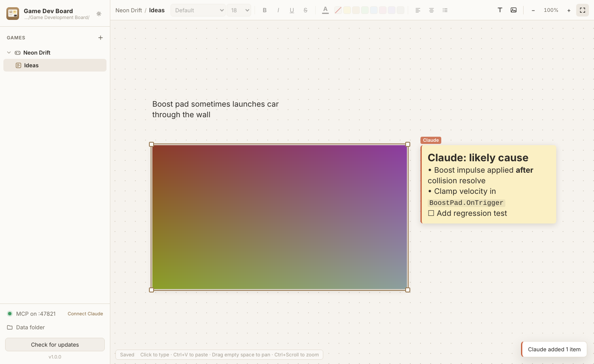

# Game Development Board

A clean, MCP-first Windows desktop app for organizing game development ideas.
Each **game** is a folder; each game holds **boards**, which are infinite canvases for notes and screenshots.
Claude can read and write the boards over MCP.



**Download the latest installer:**
https://github.com/trendlinepros-afk/Game-Development-Board/releases/latest/download/Game-Development-Board-Setup.exe

> The installer is unsigned, so Windows SmartScreen may say "Windows protected your PC".
> Click **More info → Run anyway**.

## Using the board

| Action | How |
| --- | --- |
| Type a note | Click anywhere on empty canvas and start typing |
| Paste a screenshot | `Ctrl+V` (it lands where your mouse is) |
| Add image files | Drag & drop onto the canvas, or the image button in the toolbar |
| Move | Drag an item (text notes: drag the grip above the selected note) |
| Resize | Drag the corner handles (images keep aspect ratio; hold `Shift` for free resize). Text notes: drag the right edge |
| Edit a note | Double-click it, or select it and press `Enter` |
| Format | Font, size, **bold**, *italic*, underline, strike, color, note background, alignment, bullets. With text highlighted inside a note the format applies to the selection; otherwise to the whole note |
| Pan | Drag empty space, scroll, middle-mouse drag, or hold `Space` and drag |
| Zoom | `Ctrl+Scroll`, `Ctrl +` / `Ctrl -`, `Ctrl+0` (100%), `Ctrl+1` (fit) |
| Multi-select | `Shift`+click, or `Shift`+drag a box on empty space |
| Undo / redo | `Ctrl+Z` / `Ctrl+Y` |
| Duplicate / delete | `Ctrl+D` / `Delete` |
| Copy an image back out | Select it and press `Ctrl+C` |
| Dark mode | Sun/moon button at the top of the sidebar |
| Draw | Second toolbar: select (`V`), free draw (`P`), highlighter (`H`), line (`L`), arrow (`A`), rectangle (`R`), ellipse (`O`), eraser (`E`). `Shift` snaps lines/arrows to 45° and makes squares/circles. `Esc` returns to select |
| Stroke style | Pick a color, width or dashed. With drawings selected, the change applies to them |
| Edit drawings | Select a drawing to move it, drag its corners to resize, or drag the ends of a line/arrow |
| Spelling | Right-click a misspelled word while editing a note for suggestions or "Add to dictionary"

Everything saves automatically. Right-click items, boards or games for more options.

## Where the data lives

By default it's in `Documents\Game Development Board\`:

```
Game Development Board\
  Neon Drift\              <- a game (folder)
    Ideas\                 <- a board (folder)
      board.json           <- notes, positions, formatting
      images\img_*.png     <- pasted screenshots
```

Folders you create in Explorer show up in the app. To use a different location, click **Data folder** in the sidebar.

## Sharing with your team (export / import)

Anyone on the team can install the app from the download link above.

* **Export:** right-click a game → **Export game…** (all its boards), or a board → **Export board…**.
  This saves one `.gdboard` file that holds the notes, screenshots and drawings. Send it however you like.
* **Import:** click the **Import** button (down-arrow next to **+** above the games list), or drag a `.gdboard` file onto the app.
  Choose to add it to an existing game or create a new one. A board with a name you already have is added alongside it,
  e.g. "Ideas (2)", so nothing of yours is overwritten.

**Import safety.** An import file is treated as untrusted:

* It's plain data (JSON). Nothing in it is ever run.
* Note formatting is rebuilt from an allow-list of basic tags (bold, italic, colors, lists…). Scripts, event handlers, links, iframes,
  SVG and external `url()` references are removed. Notes are cleaned again every time they are displayed.
* Images are accepted only if their bytes are a real PNG, JPEG, GIF, WebP or BMP (never SVG). PNG and JPEG images are decoded and
  re-encoded so only the pixels are kept.
* File and folder names from the export are never used on disk as-is. Images get new random names, and game/board names are cleaned,
  so an export can't write outside your data folder.
* Unknown item types, malformed values and oversized content are dropped, and the import dialog lists anything that was skipped.

## Connecting Claude (MCP)

While the app is running it hosts an MCP server at `http://127.0.0.1:47821/mcp`.
Click **Connect Claude** in the sidebar for one-click setup:

* **Claude Desktop**: "Add to Claude Desktop" writes the entry into `claude_desktop_config.json`, then restart Claude Desktop.
  The entry runs a small stdio bridge using the app's own executable. It forwards to the running app, so changes show up live,
  or reads and writes the files directly if the app is closed.
* **Claude Code**:
  ```
  claude mcp add --transport http --scope user game-dev-board http://127.0.0.1:47821/mcp
  ```

### Tools

| Tool | What it does |
| --- | --- |
| `list_games` | All games and their boards |
| `get_active_board` | The board the user has open right now |
| `list_boards` | Boards in a game |
| `get_board` | Every item: note text and formatting, image ids, drawings, positions. `include_images: true` attaches the screenshots |
| `get_image` | One image, so Claude can look at it |
| `search_boards` | Full-text search across everything |
| `create_game`, `create_board` | Create folders |
| `add_text` | Write a note (markdown supported). `near_item_id` places it next to a screenshot |
| `update_text` | Replace or append text, change formatting or position |
| `add_image` | Place an image from a file path or base64 |
| `add_shape` | Draw an arrow, line, rectangle or ellipse, e.g. to point at a bug in a screenshot |
| `move_item`, `set_image_caption`, `delete_item` | Arrange and tidy up |

Claude's notes get an orange "Claude" tag on the board. You get a toast when Claude changes the board you're looking at.

## Updates

**Check for updates** in the bottom-left asks GitHub Releases for a newer version, then downloads it and restarts into it.
The app also checks quietly at startup and shows a dot on the button when an update is available.

### Shipping a new version

1. Bump `"version"` in `package.json`, e.g. `1.0.0` → `1.0.1`.
2. Push to `main`.

The **Build & Release** GitHub Action tests the code, builds the NSIS installer on Windows and publishes the `v1.0.1` release
with `latest.yml`. Installed apps then find it with **Check for updates**.
A push that doesn't change the version only builds; it doesn't publish anything.

## Development

```
npm install
npm start      # run the app
npm test       # core + MCP tests
npm run dist   # build the installer locally (on Windows)
```

Layout:

* `src/core/`: data store, MCP tools, HTTP + stdio transports. Plain Node with no dependencies; also shipped as `resources/mcp-server`.
* `src/main/`: Electron main process, IPC, auto-updater.
* `src/renderer/`: UI (plain HTML/CSS/JS): sidebar, canvas, toolbar.
